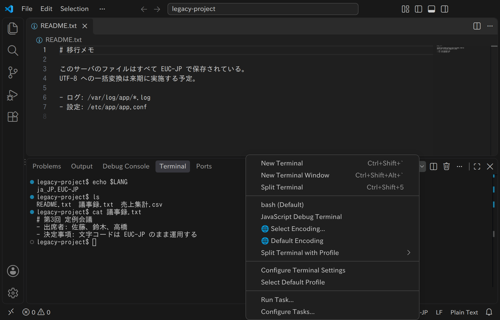

# Terminal Any Encoding

[English version here](README.md)

VS Code の統合ターミナルで、EUC-JP や Shift JIS など UTF-8 以外の文字エンコーディングを使えるようにする拡張機能です。VS Code が対応する Unicode 以外のエンコーディング 45 種類すべてを使えます。

[Visual Studio Marketplace](https://marketplace.visualstudio.com/items?itemName=yutotnh.terminal-any-encoding) または [Open VSX](https://open-vsx.org/extension/yutotnh/terminal-any-encoding) からインストールできます。



## 動作要件

VS Code 1.73.0 以降が必要です。対応 OS は次のとおりです（リモート接続では接続先の OS）。

| OS      | 対応                                              |
| ------- | ------------------------------------------------- |
| Linux   | x64、arm64、armhf（Alpine Linux は x64 と arm64） |
| macOS   | x64、arm64                                        |
| Windows | 非対応                                            |

## 使い方

ターミナルパネルの `+` の横にある ▼ から `🌐 Select Encoding...` を選び、エンコーディングを選ぶと、そのエンコーディングのターミナルが開きます。コマンドパレットの「エンコーディングを指定してターミナルを開く...」からも開けます。bash、zsh、fish、pwsh では、通常のターミナルと同じようにシェル統合も使えます。

毎回選ぶのを省くには、次のいずれかの方法を使います。

- [`terminalAnyEncoding.defaultEncoding`](#設定) にエンコーディングを設定し、`🌐 Default Encoding` を選ぶ
- [キーバインディング](#キーバインディング)を登録する
- [この拡張機能のターミナルを既定のターミナルにする](#この拡張機能のターミナルを既定のターミナルにする)

### キーバインディング

コマンド `terminalAnyEncoding.openTerminal` の引数にエンコーディングの id を渡すと、そのエンコーディングのターミナルを 1 回のキー操作で開けます。id は `files.encoding` に指定する値（`eucjp`、`shiftjis` など）と同じで、選択画面にも表示されます。

```json
[
  {
    "key": "ctrl+alt+e",
    "command": "terminalAnyEncoding.openTerminal",
    "args": "eucjp"
  }
]
```

### この拡張機能のターミナルを既定のターミナルにする

`terminal.integrated.defaultProfile.linux`（macOS では `.osx`）を `🌐 Default Encoding` にすると、「新しいターミナル」（Ctrl+Shift+\`）でこの拡張機能のターミナルが開きます。中で起動するシェルは `shellProfile.*` で指定できます（指定しなければ `$SHELL`）。

```json
{
  "terminalAnyEncoding.defaultEncoding": "eucjp",
  "terminal.integrated.defaultProfile.linux": "🌐 Default Encoding",
  "terminalAnyEncoding.shellProfile.linux": "zsh"
}
```

## 設定

| 設定                                              | 内容                                                                                                                                            |
| ------------------------------------------------- | ----------------------------------------------------------------------------------------------------------------------------------------------- |
| `terminalAnyEncoding.defaultEncoding`             | `🌐 Default Encoding` で使うエンコーディング。空欄（既定値）なら毎回選択画面を表示します                                                        |
| `terminalAnyEncoding.shellProfile.linux` / `.osx` | ターミナル内で起動するシェルのプロファイル名（`terminal.integrated.profiles.*` で定義した名前）。空欄（既定値）なら既定のプロファイルを使います |
| `terminalAnyEncoding.warnAboutLocale`             | エンコーディングに合うロケールがないときに警告するかどうか。既定値は `true`                                                                     |

## ロケールの自動設定

ターミナルを開くと、エンコーディングに合うロケール（EUC-JP なら `ja_JP.EUC-JP` など）を `LANG` に設定し、`date` や `ls` もそのエンコーディングで出力するようにします。合うロケールがホストにない場合は、生成すべきロケールを通知で知らせます。

ただし、次のエンコーディングには glibc のロケールがそもそもないため、`date` や `ls` の表示が崩れることがあります（生成もできないので、通知は出ません）。

- Shift JIS（ディストリビューションが `ja_JP.sjis` などを追加している場合を除く）
- Windows 874
- DOS のコードページ（CP 437、850、852、857、865、866）

また、`~/.bashrc` などで `LANG` や `LC_ALL` を設定していると、この拡張機能の設定が上書きされて表示が崩れます。この場合は通知も出ないため、次のように未設定のときだけ設定する書き方にしてください。

```sh
export LANG="${LANG:-ja_JP.UTF-8}"
```

## タスク

`tasks.json` で `terminalAnyEncoding` タイプのタスクを定義すると、そのタスクの入出力も変換されます（problem matcher も変換後の出力を解析します）。書き方は `shell` タイプと同じで、`encoding` に id を指定します。

```json
{
  "version": "2.0.0",
  "tasks": [
    {
      "label": "build",
      "type": "terminalAnyEncoding",
      "encoding": "eucjp",
      "command": "make",
      "problemMatcher": "$gcc"
    }
  ]
}
```

コマンドラインも（`${file}` などの変数の値を含めて）タスクのエンコーディングで解釈されます。そのため、名前に ASCII 以外の文字を含む UTF-8 のファイルは見つからず、エンコーディングで表せない文字を含むコマンドラインは実行されません。

## 既知の制限とトラブルシューティング

### 文字化けする、`�` が表示される

まず、ターミナルのエンコーディングが、扱っているファイルやプログラムと合っているか確認してください。合っている場合は、`locale charmap` でロケールのエンコーディングを確認してください（[ロケールの自動設定](#ロケールの自動設定)を参照）。

### 入力した文字が送信されない

エンコーディングで表せない文字（EUC-JP での絵文字など）を含む入力は送信されず、そのことを通知で知らせます。貼り付けの場合は、その貼り付けの残りも送信されません。

### ほかのタイプのタスクやデバッグの出力が変換されない

変換されるのは、この拡張機能のターミナルと [`terminalAnyEncoding` タイプのタスク](#タスク)だけです。デバッグの出力は変換できません。

### macOS でタブ名が変わらない

macOS では、タブ名が開いたときの名前（`bash (EUC-JP)` など）のまま変わりません。

### `～` と `№` のバイト列がエディタで保存したものと異なる

EUC-JP のターミナルでは、`～` と `№` を wave-dash-unify 拡張機能と同じ `A1 C1` と `AD E2` で送信します。VS Code のエディタだけで保存したもの（`8F A2 B7` と `8F A2 F1`）とは異なりますが、ほかのツールでも読めるバイト列です。`〜`（U+301C）も同じ波ダッシュとして送信します（Shift JIS では `81 60`）。

## 開発

[CONTRIBUTING.md](CONTRIBUTING.md)（英語）を参照してください。

## ライセンス

MIT ライセンスです。同梱しているソフトウェアのライセンスは [THIRD-PARTY-NOTICES.md](THIRD-PARTY-NOTICES.md) を参照してください。
