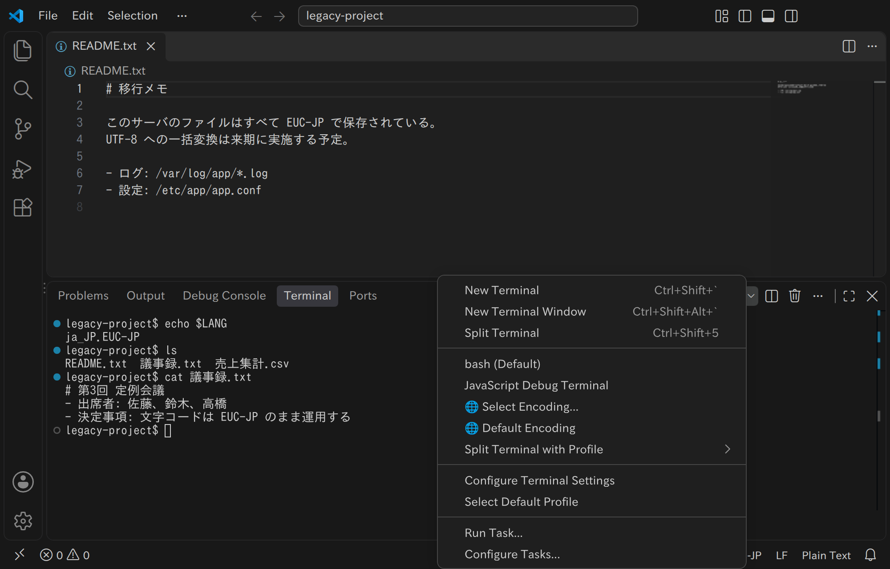

# Terminal Any Encoding

[日本語版はこちら / Japanese version](README.ja.md)

Use non-UTF-8 encodings such as EUC-JP and Shift JIS in the VS Code integrated terminal.
All 45 non-Unicode encodings VS Code supports are available.

Install from the [Visual Studio Marketplace](https://marketplace.visualstudio.com/items?itemName=yutotnh.terminal-any-encoding) or [Open VSX](https://open-vsx.org/extension/yutotnh/terminal-any-encoding).



## Requirements

VS Code 1.73.0 or later.
Supported operating systems (for a remote connection, the remote host's):

| OS      | Support                                   |
| ------- | ----------------------------------------- |
| Linux   | x64 / arm64 / armhf (Alpine: x64 / arm64) |
| macOS   | x64 / arm64                               |
| Windows | Not supported                             |

## Getting Started

Pick an encoding from `🌐 Select Encoding...` in the ▼ next to the `+` button in the terminal panel, or run "Open Terminal with Encoding..." from the Command Palette.
Shell integration works for bash, zsh, fish and pwsh, as in VS Code's own terminals.

To skip the picker:

- set [`terminalAnyEncoding.defaultEncoding`](#settings) and pick `🌐 Default Encoding`,
- bind a [key](#keybindings), or
- [make it your default terminal](#using-this-extension-as-your-default-terminal).

### Keybindings

Pass an encoding's id to `terminalAnyEncoding.openTerminal` to open it with one key.
An id is the same as VS Code's `files.encoding` value (`eucjp`, `shiftjis`, etc.) and is also shown in the picker.

```json
[
  {
    "key": "ctrl+alt+e",
    "command": "terminalAnyEncoding.openTerminal",
    "args": "eucjp"
  }
]
```

### Using this extension as your default terminal

Set `terminal.integrated.defaultProfile.linux` (`.osx` on macOS) to `🌐 Default Encoding`, and "New Terminal" (Ctrl+Shift+\`) opens this extension's terminal.
Choose the shell it starts with `shellProfile.*` (`$SHELL` without it).

```json
{
  "terminalAnyEncoding.defaultEncoding": "eucjp",
  "terminal.integrated.defaultProfile.linux": "🌐 Default Encoding",
  "terminalAnyEncoding.shellProfile.linux": "zsh"
}
```

## Settings

| Setting                                           | Description                                                                                                                             |
| ------------------------------------------------- | --------------------------------------------------------------------------------------------------------------------------------------- |
| `terminalAnyEncoding.defaultEncoding`             | Encoding used by `🌐 Default Encoding`. Empty (the default) shows the picker each time.                                                 |
| `terminalAnyEncoding.shellProfile.linux` / `.osx` | Profile (a name from `terminal.integrated.profiles.*`) of the shell the terminal starts. Empty (the default) uses your default profile. |
| `terminalAnyEncoding.warnAboutLocale`             | Warn when no matching locale is available (default `true`).                                                                             |

## Locale Detection

Each terminal gets `LANG` set to a locale matching its encoding (e.g. `ja_JP.EUC-JP`), so `date` and `ls` write in that encoding too.
If the matching locale isn't installed on the host, a notification names the locale to generate.

glibc has no locale at all for the following encodings, though, so `date` and `ls` may display text wrong (there's nothing to generate, so no notification is shown):

- Shift JIS (unless your distribution adds one like `ja_JP.sjis`)
- Windows 874
- the DOS code pages (CP 437, 850, 852, 857, 865 and 866)

If `~/.bashrc` or similar sets `LANG` or `LC_ALL`, it overrides this extension's value and text displays wrong, with no notification.
Set it only when it isn't set yet:

```sh
export LANG="${LANG:-ja_JP.UTF-8}"
```

## Tasks

A task of type `terminalAnyEncoding` has its input and output converted (problem matchers read the converted output too).
Write it like a `shell` task, plus an `encoding` (an id):

```json
{
  "version": "2.0.0",
  "tasks": [
    {
      "label": "build",
      "type": "terminalAnyEncoding",
      "encoding": "eucjp",
      "command": "make",
      "problemMatcher": "$gcc"
    }
  ]
}
```

The command line (including values of variables like `${file}`) is interpreted in the task's encoding too.
So files with non-ASCII UTF-8 names aren't found, and a command line with a character the encoding can't represent isn't run.

## Known Limitations and Troubleshooting

### Mojibake or `�`

First check that the terminal's encoding matches the files or programs you're working with.
If it does, run `locale charmap` to check the locale's encoding (see [Locale Detection](#locale-detection)).

### Typed input isn't sent

Input with a character the encoding can't represent (e.g. an emoji in EUC-JP) isn't sent, and a notification says so.
If it was pasted, the rest of the paste isn't sent either.

### Output of other task types and of debug sessions isn't converted

Only this extension's terminals and [tasks of type `terminalAnyEncoding`](#tasks) are converted.
There's no way to convert debug output.

### Tab names don't change on macOS

On macOS, a tab's name stays as it started, e.g. `bash (EUC-JP)`.

### `～` and `№` become different bytes than the editor saves

An EUC-JP terminal sends `～` and `№` as `A1 C1` and `AD E2`, the same bytes the wave-dash-unify extension saves.
VS Code's editor alone saves `8F A2 B7` and `8F A2 F1` instead, which other tools can't read.
`〜` (U+301C) is sent as the same wave dash (`81 60` in Shift JIS).

## Contributing

See [CONTRIBUTING.md](CONTRIBUTING.md).

## License

MIT.
See [THIRD-PARTY-NOTICES.md](THIRD-PARTY-NOTICES.md) for bundled third-party licenses.
